# HDB Resale Explorer

I built this OutSystems 11 app to answer one question with real HDB resale data: what have flats like mine actually sold for, and are prices going up or down?

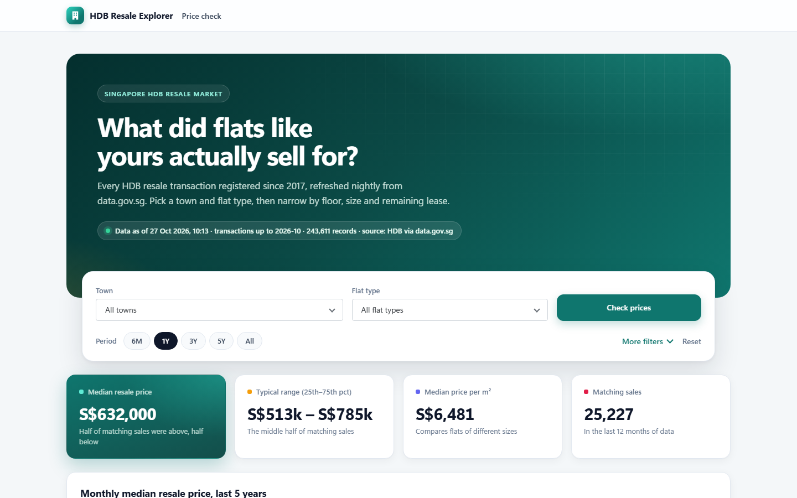

## Try it

| What | Link | Notes |
|---|---|---|
| PriceCheck (public site) | https://atul-persistent.outsystemscloud.com/SingaporeHDBInsight/ | No login needed |
| SyncAdmin (admin console) | https://atul-persistent.outsystemscloud.com/HDBResale_Admin/SyncAdmin | Needs a user with the `HDBAdmin` role |
| Health endpoint | https://atul-persistent.outsystemscloud.com/HDBResale_Core/rest/HealthAPI/Health | JSON, used by monitoring and the pipeline |

These run on my OutSystems cloud environment. If nobody has used it for a while, the first page load can take a few seconds.

## Contents

- [Where things stand](#where-things-stand)
- [Screenshots](#screenshots)
- [0. Dataset](#0-dataset)
- [1. What the app does and who it's for](#1-what-the-app-does-and-whos-for)
- [2. Architecture](#2-architecture)
- [3. Key decisions and trade-offs](#3-key-decisions-and-trade-offs)
- [4. Assumptions](#4-assumptions)
- [5. Security, compliance and performance](#5-security-compliance-and-performance)
- [6. Deploying and running the tests](#6-deploying-and-running-the-tests)
- [7. What's manual and what's automated](#7-whats-manual-and-whats-automated)
- [8. Known gaps and next steps](#8-known-gaps-and-next-steps)

## Where things stand

As of 28 Oct 2026:
- **The apps:** all four modules publish without errors. The public site works on desktop and on a phone with the full dataset.
- **The nightly sync:** it has succeeded every night since 24 Oct. The latest run, on 27 Oct, loaded 243,611 rows with none rejected and took about 13 minutes.
- **Not run yet:** the automated test suites, and the Terraform and pipeline against a real AWS account or LifeTime.

Section 8 lists what I've verified and what I haven't.

A copy of this repository's text files is also stored in `HDBResale_Core` as resources (not the screenshots). Their deploy action is set to Ignore, so they're never served. Git is the source of truth.

## Screenshots

PriceCheck after searching for TAMPINES and 4 ROOM, with "More filters" open:

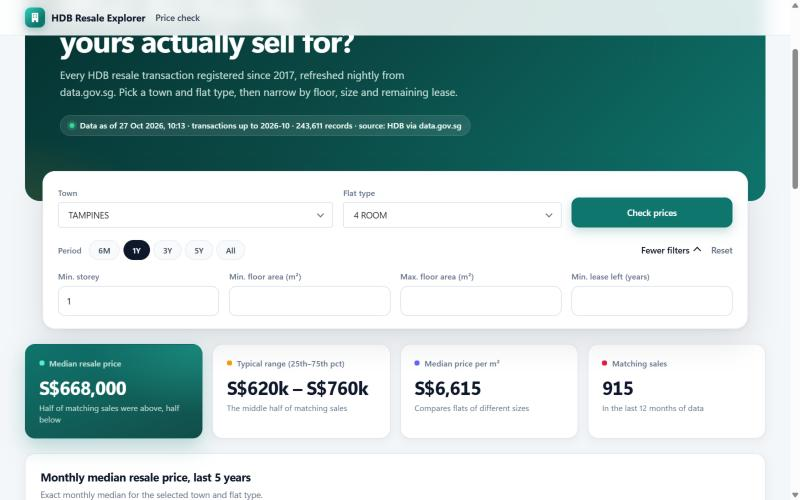

The full page, showing the trend chart and the transactions list:

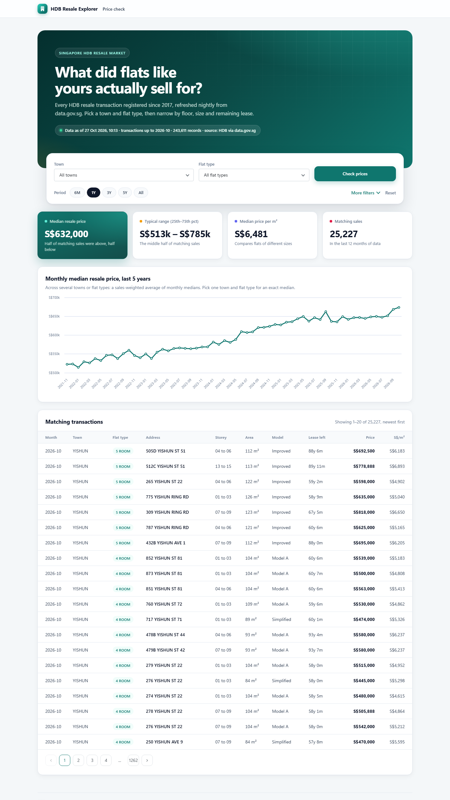

On a phone, the transactions turn into cards:

<p>
  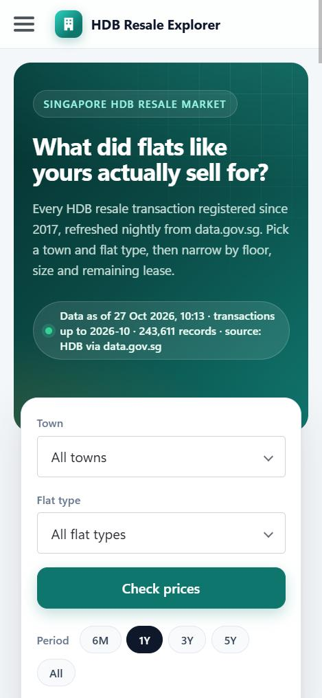
  &nbsp;&nbsp;
  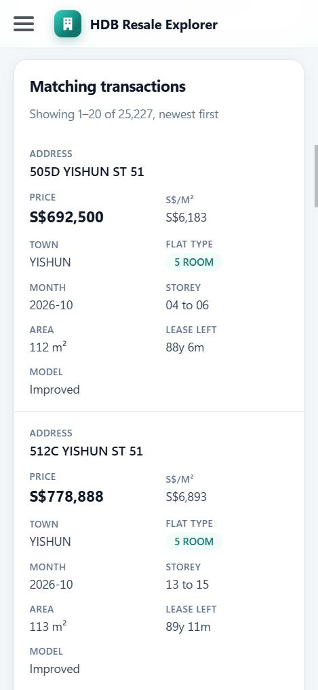
</p>

The admin console has its own look, so it's never confused with the public site. Here's SyncAdmin after four nightly runs:

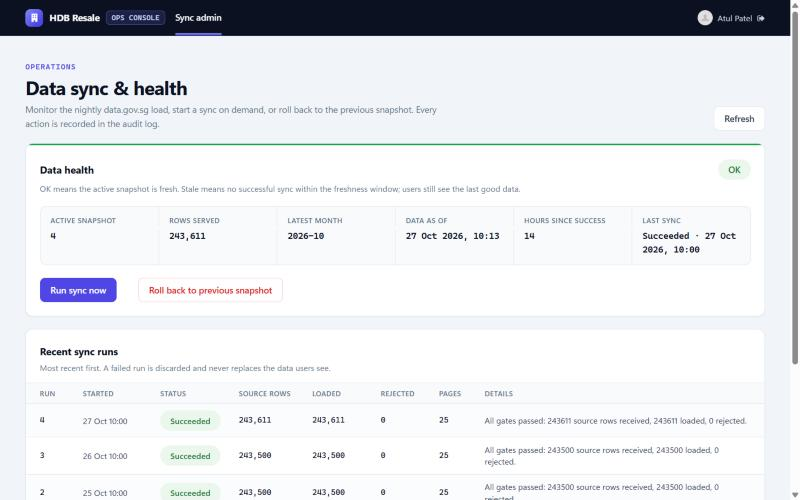

The same screen at tablet width, where the health figures stack into a list, and the sign-in page anonymous visitors are sent to:

<p>
  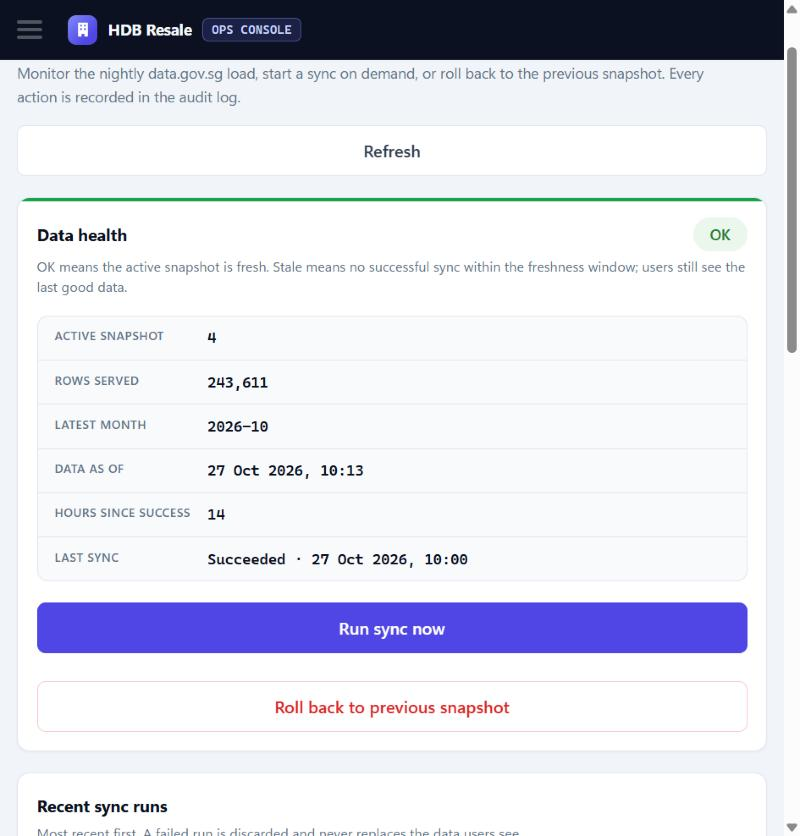
  &nbsp;&nbsp;
  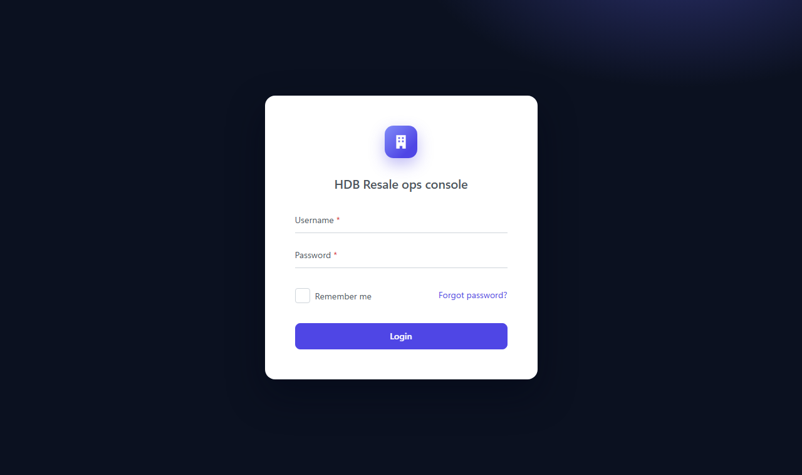
</p>

## 0. Dataset

I used [Resale flat prices based on registration date from Jan-2017 onwards](https://data.gov.sg/datasets/d_8b84c4ee58e3cfc0ece0d773c8ca6abc) from HDB (resource id `d_8b84c4ee58e3cfc0ece0d773c8ca6abc`).

When I checked the API on 24 Oct 2026:
- It had 243,399 rows and 11 fields.
- Almost everything comes back as text. Remaining lease looks like `"61 years 04 months"` and storey like `"10 TO 12"`, so it needs real parsing.
- Pages of 10,000 rows work, at about 2.8 MB and 15 seconds each.
- Anonymous callers get HTTP 429 after about 5 quick calls.

I picked it for three reasons:
- It's big enough that loading, validation and paging actually matter.
- The text fields give the tests something real to check.
- The rate limit forced me to think properly about what happens when data.gov.sg is slow or down.

The question a user can answer: "I have a 4-room flat in Tampines on a high floor with about 60 years of lease left. What have similar flats sold for recently, and what's the trend?"

## 1. What the app does and who it's for

**PriceCheck** is public, needs no login, and is for buyers, sellers and agents.
- You pick a town and flat type, and get:
  - the median price
  - the typical range (25th to 75th percentile)
  - the median price per m²
  - the number of sales
  - a five-year monthly trend chart
  - the matching transactions, newest first
- Period chips (6M up to All) change the time window.
- "More filters" opens storey, floor area and remaining lease.
- A badge at the top shows how fresh the data is. It turns amber if no sync has succeeded for 48 hours.

**SyncAdmin** is for the people who run the app. It lives in a separate module and needs the `HDBAdmin` role. In production it can only be reached from the office network. It shows:
- data health
- *Run sync now* and *Roll back to previous snapshot* buttons (rollback asks for confirmation)
- recent sync runs
- the audit log

## 2. Architecture

### The big picture

I build in Service Studio and publish to Dev, the same as any OutSystems project. Everything after that is automated:
- **GitHub Actions** tells LifeTime when to move a version to Test and Prod, and only after the tests pass.
- **Terraform** describes the AWS servers as code.
- **A CloudWatch canary** watches production and emails someone if it's unhealthy.

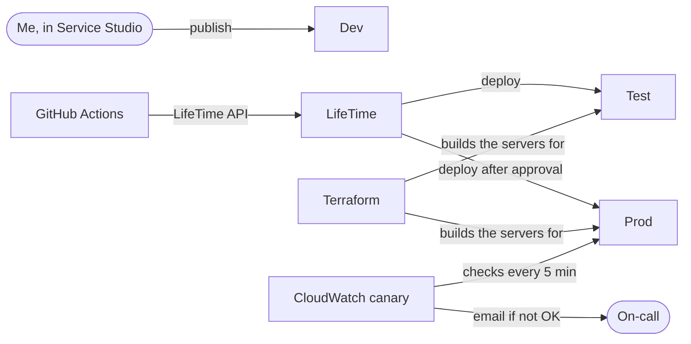

### Production on AWS

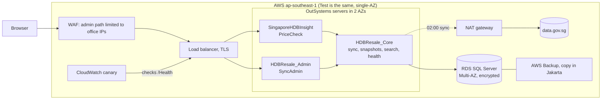

### Modules

The UI, Admin and Tests modules depend on Core, and nothing depends on them. That keeps test code and admin screens out of the public app.

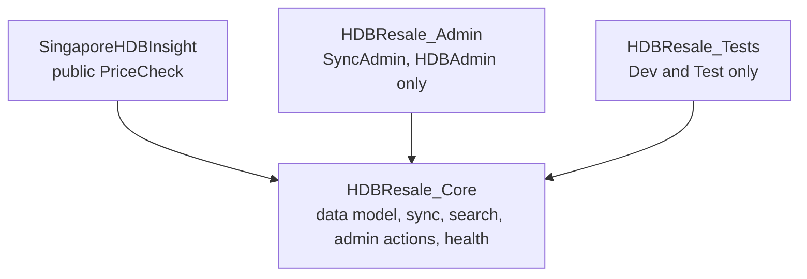

| Module | Type | What it does | Environments |
|---|---|---|---|
| `HDBResale_Core` | Service | Data model, nightly sync, snapshots, search, admin actions, health endpoint | Dev, Test, Prod |
| `SingaporeHDBInsight` | Reactive web | The public PriceCheck screen | Dev, Test, Prod |
| `HDBResale_Admin` | Reactive web | The SyncAdmin screen | Dev, Test, Prod |
| `HDBResale_Tests` | Service, in its own LifeTime app | 51 automated tests, a data.gov.sg mock and a test runner API | Dev and Test only |

### How the nightly sync works

The screens only ever read the snapshot that `AppState` points to. A new snapshot is built next to the old one, and is only switched on once it has passed every check.

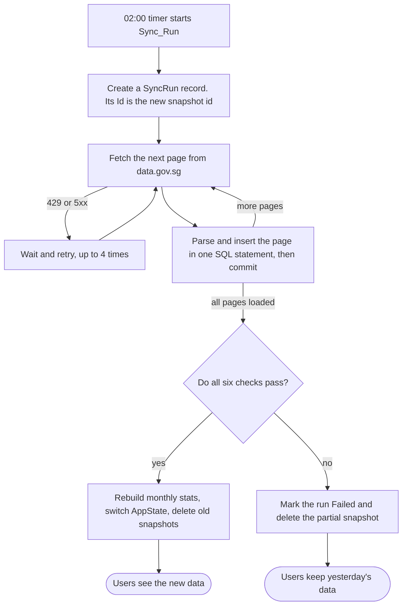

## 3. Key decisions and trade-offs

### Hosting: O11 on AWS or ODC

I went with self-managed O11 on AWS because the brief asks for explicit control over RPO, RTO and disaster recovery. With O11 I own the VPC, the database, the backups and the DR region. The cost is that I also own patching, certificates, scaling and restore drills.

ODC would take most of that work away. But it runs on PostgreSQL with no direct database access, and I rely on SQL Server features (`OPENJSON`, `PERCENTILE_CONT`, `OFFSET/FETCH`). If there were no existing O11 estate, I'd choose ODC and port those queries.

### Resilience

The resale data can always be reloaded from data.gov.sg. What really needs protecting is the sync history, the audit log and the user accounts.

| Scenario | RPO | RTO | How |
|---|---|---|---|
| One server lost | 0 | about 0 | Load balancer health checks, servers in 2 AZs |
| AZ lost | 0 | 5 min or less | RDS Multi-AZ standby |
| Bad data loaded | 0 | seconds | SyncAdmin, *Roll back to previous snapshot* |
| Corruption or operator error | 5 min or less | 1 h or less | RDS point-in-time restore |
| Region lost | 24 h or less | 8 h or less | Cross-region backup copy, rebuild from Terraform, restore, re-sync |

Prod uses Multi-AZ; Dev and Test are single-AZ. The restore steps are in `docs/runbooks/dr-restore.md`, and they should be practised once a quarter.

### Data access: a nightly sync, not live calls

Calling data.gov.sg on every search was never really an option:
- the rate limit is tiny
- the API can't aggregate
- the fields are text
- their outage would become my outage

A nightly sync means the data is at most a day old, which is fine for figures reported monthly.

I reload everything into a new snapshot each night, instead of updating rows in place:
- There's no reliable business key; two identical sales are legitimately two rows.
- HDB revises past months.
- At about 245k rows, a full reload is cheap.
- Snapshots give me an atomic switch-over and an instant rollback.

Before a snapshot goes live, `Sync_Validate` checks:

| Code | Fails when |
|---|---|
| `EMPTY` | The source reports 0 rows |
| `TRUNCATED` | Rows received don't match the source total |
| `MISMATCH` | Rows loaded plus rows rejected don't match rows received |
| `REJECTS` | More than 0.1% of rows were rejected |
| `SHRUNK` | The new snapshot has less than 99% of the current one's rows |
| `MONTH` | The latest month went backwards |

When data.gov.sg is slow or down, users notice nothing except the freshness badge.
- Calls are paced: 12 seconds between pages, with a 120-second timeout.
- HTTP 429 and 5xx responses are retried up to 4 times, with exponential backoff starting at 15 seconds.
- HTML, `success:false` or an empty page makes the run fail cleanly. It tries again the next night, or an admin can run it by hand.
- The API key is optional and only sent when it's set.

### Application design

The entities live in Core and are read-only to other modules:
- **`ResaleTransaction`:** the parsed columns plus `SnapshotId`.
- **`MonthlyStat`:** count, median, 25th and 75th percentiles and median price per m², for each snapshot, month, town and flat type.
- **`SyncRun`, `AppState` and `AdminAuditLog`:** the run history, the pointer to the active and previous snapshot, and the admin actions.
- **`SyncRejectedRow`:** the raw JSON and the reason for every rejected row.
- Static entities for towns, flat types and sync status.

Search:
- **Paging** happens on the server, with `OFFSET/FETCH` and `COUNT(*) OVER ()` for the total.
- **Medians** use `PERCENTILE_CONT`. Optional filters use the `@X = 0 OR ...` pattern with `OPTION (RECOMPILE)`.
- **The chart** only reads `MonthlyStat`.
- **Caching:** server actions are cached for 60 minutes (summary and trend) or 10 minutes (rows). The cache key includes `SnapshotId`, so every switch-over clears the cache automatically.
- **Limits:** page size is capped at 100 and the period at 120 months, which limits what one anonymous request can cost.

I put the admin screen in its own module.
- **Why:** the whole `/HDBResale_Admin/` path can be blocked at the WAF for anyone outside the office network. It also keeps admin code out of the public app, and the two can be released separately.
- **Cost:** one more module and a second theme.
- Both modules call the same Core actions, so the security logic isn't duplicated.

The two web apps look different on purpose:
- **Public site:** teal and consumer-style, with a hero, a search panel and cards.
- **Admin console:** a dark header, indigo accents, compact tables and monospaced numbers.

Both themes override the OutSystems UI tokens so the built-in widgets match. Neither loads external fonts or images. Both turn tables into stacked cards on a phone.

### Testing

The 51 tests are in `HDBResale_Tests`, a separate LifeTime app that never goes to production.
- **Unit (17):** call pure functions. They cover every validation rule and its edge cases, plus the small helpers.
- **Integration (26):** create their own data, call real Core actions against the real database, check the result, then abort the transaction so the database ends up exactly as it was. They cover:
  - the loader, including all 9 reject reasons
  - snapshot activation, with exact median and percentile values
  - purge and rollback
  - every search filter, paging and the trend
  - the health endpoint
  - the three admin actions refusing non-admins
- **End-to-end (7):** run a full `Sync_Run` against a mock of data.gov.sg. The scenarios are:
  - normal
  - two failures then success
  - a long outage
  - a truncated source
  - a shrunk dataset
  - `success:false`

  `Sync_Run` commits page by page, so these tests save the latest run and `AppState` first and restore them afterwards. The suite also checks first that Core really points at the mock, so it can never sync the real dataset by accident.
- **Contract (1):** pulls 5 real rows from data.gov.sg through the real parser every night, to catch format changes early. It reports, but doesn't block releases.

One problem I hit: OutSystems won't let another module write to Core's read-only entities, not even through SQL. I didn't want to open the tables up, so Core has four small `TestSupport_*` actions:
- `CreateSyncRun`
- `SetAppState`
- `InsertMonthlyStat`
- `DeleteRunsAfter`

They do nothing unless the `TestSupportEnabled` site property is True, and it's False in production.

The mock, `DataGovMock`, serves the same URL and JSON as data.gov.sg. `MockState` sets how many rows to return, what total to report, how many calls fail first, and whether to return `success:false`.

A test run is only queued by the web request and is executed by a timer, so long suites don't hit HTTP timeouts:

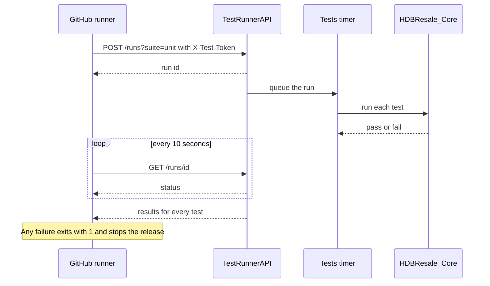

Both calls need `TestsEnabled = True` and the `X-Test-Token` header.

## 4. Assumptions

- data.gov.sg keeps the same resource id and field names. If that changes, the `REJECTS` and `EMPTY` checks and the nightly contract test will catch it.
- Data up to 24 hours old is acceptable.
- The dataset stays under about a million rows.
- SQL Server 2016 or later (compatibility level 130 or higher, for `OPENJSON`). RDS meets this.
- The servers run on Singapore time, because the 02:00 timer uses server time. Terraform sets this on the AWS servers. My OutSystems cloud environment runs on UTC, so there the sync starts at 10:00 Singapore time instead.
- Fewer than 100 people use the app at the same time.
- An O11 licence, LifeTime and a corporate identity provider already exist.

## 5. Security, compliance and performance

### Security

**Public access**
- PriceCheck is public on purpose, because the data is open.
- In production, admins would sign in through SAML or Azure AD with MFA.

**Admin access has three independent layers**
1. The WAF blocks `/HDBResale_Admin/` outside the allowed IP ranges.
2. The SyncAdmin screen requires `HDBAdmin`.
3. Every `Admin_*` action checks the role again on the server. The tests confirm that non-admins are refused.

**What anonymous users can reach**
- The only server call open to them is `UI_SearchRun`, which is read-only, input-limited and cached. TrueChange warns about it; that's expected.
- The health endpoint returns metadata only.
- The load-test `SearchAPI` is off unless `SearchApiEnabled` is set.
- The WAF limits each IP to 1,000 requests per 5 minutes.

**Test code**
- The test module never goes to production, and it needs both `TestsEnabled` and a token.
- The `TestSupport_*` actions do nothing unless `TestSupportEnabled` is set.

**Secrets and encryption**
- The data.gov.sg key and the test token are Secret site properties with no default values. They're stored in AWS Secrets Manager and rotated every 90 days.
- TLS 1.2 or higher at the load balancer, encrypted database connections, and KMS encryption for RDS, snapshots and disks.

**Least privilege**
- Separate runtime and admin database logins; the runtime login can only read and write data.
- IAM is limited to this stack's secrets, and the security groups are tight.
- Service Center and LifeTime can only be reached over VPN or SSM.

**Audit and SQL**
- `AdminAuditLog`, `SyncRun`, `SyncRejectedRow`, the retry logs, load balancer logs and CloudTrail are kept for a year.
- All SQL is parameterised. I never use Expand Inline.

### Compliance

- **Licence:** the data is under the Singapore Open Data Licence v1.0, and the required attribution is in the footer.
- **Personal data:** there isn't any. The finest detail is a block and a three-storey band, so PDPA doesn't really apply.

### Performance

The targets:
- search p95 under 800 ms uncached and under 100 ms cached
- a full sync in under 15 minutes

On my environment a full sync takes about 13 minutes (25 pages of 10,000 rows), so it's inside the target. I haven't measured search latency yet. The k6 script in `tests/load` enforces those thresholds.

## 6. Deploying and running the tests

`docs/HANDOVER.md` is the step-by-step guide for setting this up from scratch, including Terraform, the OutSystems install and GitHub. The short version is below.

### First deployment

1. Publish the modules in order:
   1. `HDBResale_Core`
   2. `SingaporeHDBInsight` and `HDBResale_Admin`
   3. `HDBResale_Tests` (Dev and Test only)
2. In Service Center, set Core's site properties:
   - `DataGovSG_ApiKey`, if you have one
   - `TestSupportEnabled = True`, in Dev and Test only
   - the sync tuning values, if you need different ones
3. Give the admins the `HDBAdmin` role.
4. Open `/HDBResale_Admin/SyncAdmin` and click *Run sync now*. After about 12 minutes the run should show `Succeeded`, and health should show `OK`.
5. Try PriceCheck with TAMPINES and 4 ROOM.

### Releasing a change

Nobody deploys by hand in LifeTime. I press *Run workflow* on GitHub, and the pipeline drives LifeTime through its API. Any failed step stops the run before anything reaches production.

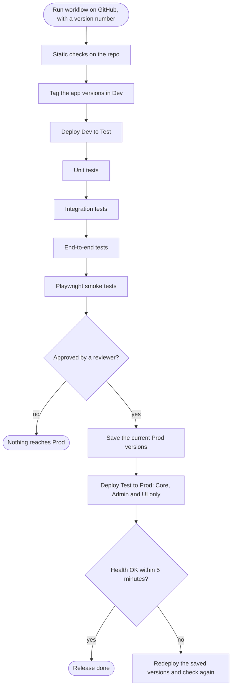

LifeTime never calls GitHub. The GitHub runner calls LifeTime, using a service-account token, and does the same steps I would click through by hand:

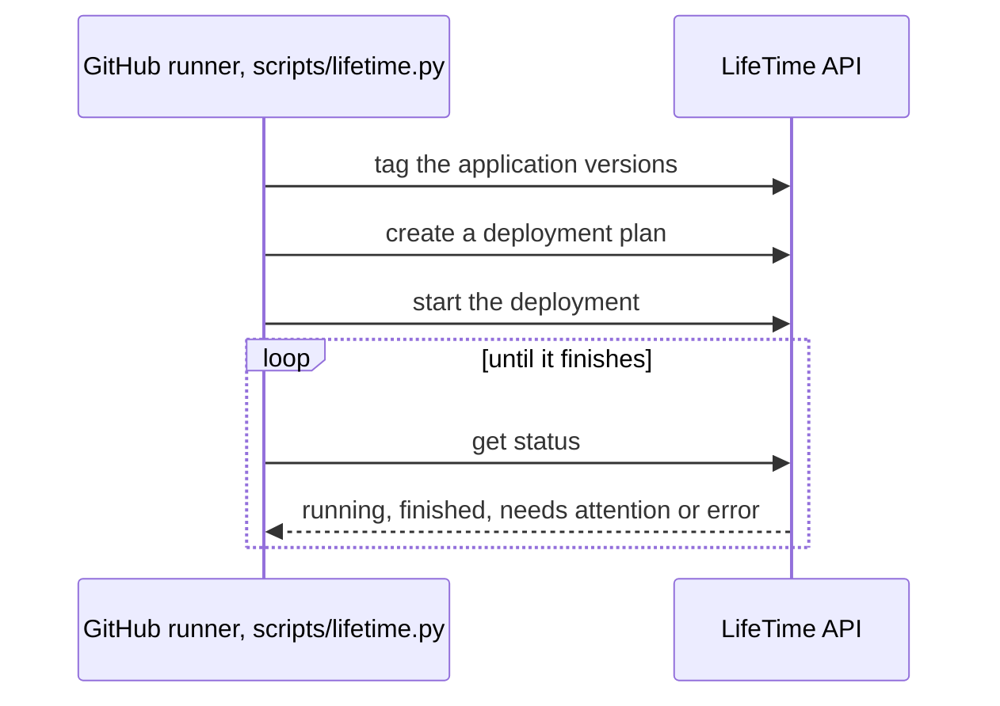

The workflows are in `.github/workflows/`:
- **`ci.yml`** runs on every pull request. It runs:
  - shellcheck
  - the LifeTime client's unit tests
  - `terraform fmt` and `validate`
  - actionlint
  - a k6 script check
  - the Playwright type check
- **`release.yml`** is the flow shown above.
- **`nightly.yml`** runs the contract test at 03:30 and opens a GitHub issue if it fails.

The pipeline needs these settings in GitHub:
- **Repository variables:**
  - `LT_URL`
  - `LT_ENV_DEV`, `LT_ENV_TEST` and `LT_ENV_PROD`
  - `LT_APPS_PROD` and `LT_APPS_TEST_ONLY`
  - `TEST_HOST` and `PROD_HOST`
  - `AI_MENTOR_URL`
- **Secrets:** `LT_TOKEN` and `TEST_API_TOKEN`.

Rolling back:
- **Code:** the pipeline rolls back automatically if the health check fails. To do it by hand, follow `docs/runbooks/release-and-rollback.md`. Schema changes are always additive, so an older version runs fine on the newer schema.
- **Data:** use *Roll back to previous snapshot* in SyncAdmin.

### Running the tests

The Test environment needs these settings first:
- **On `HDBResale_Tests`:** `TestsEnabled = True`, and a `TestApiToken`.
- **On Core:**
  - `TestSupportEnabled = True`
  - `SyncPageSize = 10`
  - `SyncPageDelaySeconds = 0`
  - `SyncRetryBaseSeconds = 1`
- **Core's DataGovSG integration:** its Effective URL must point at `https://<test-host>/HDBResale_Tests/rest/DataGovMock`. After that, the Test environment's nightly sync also uses the mock.

```bash
TESTS_BASE_URL=https://<test-host>/HDBResale_Tests TEST_API_TOKEN=*** ./scripts/run-tests.sh all junit.xml
```

The first argument is the suite: `unit`, `integration`, `e2e`, `contract` or `all`. The script:
- queues the run and checks on it every 10 seconds
- prints each result and writes a JUnit XML file
- exits with 1 if anything fails

It needs bash, curl and Python 3.

```bash
CORE_BASE_URL=https://<host>/HDBResale_Core ./scripts/check-health.sh
```

This is the check used after each deploy, and the canary uses the same rule. It fails unless the status is `OK`.

The load test calls `SearchAPI`, which runs the same search as the screen. It's off unless `SearchApiEnabled = True`, so only turn it on in the environment you're testing.

```bash
k6 run -e CORE_BASE_URL=https://<test-host>/HDBResale_Core tests/load/search.js
```

The load test ramps up to 50 users. It fails if search p95 goes over 800 ms uncached or 100 ms cached, or if more than 1% of requests fail.

```bash
cd tests/ui && npm ci && npx playwright install chromium && UI_BASE_URL=https://<test-host>/SingaporeHDBInsight/ npx playwright test
```

The Playwright tests run at desktop and phone sizes. They check:
- the page loads
- filtering, paging, the period chips and "More filters" work
- there's no horizontal scrolling
- an anonymous visitor can't reach SyncAdmin

### Infrastructure

Terraform in `infra/` builds everything below. It doesn't install OutSystems itself; that's a manual step, covered in the handover guide.

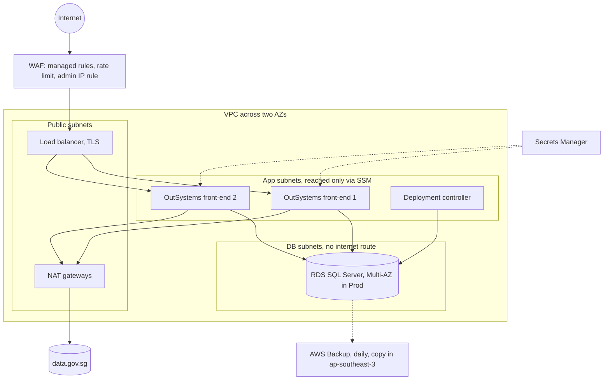

Disks, the database, backups and logs are all encrypted with KMS. The database keeps 14 days of point-in-time restore.

```bash
cd infra
terraform init -backend-config=envs/prod.backend.hcl
terraform apply -var-file=envs/prod.tfvars
```

### Monitoring

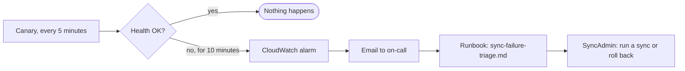

There are also alarms for:
- 5xx errors
- slow responses
- unhealthy servers
- database CPU and storage
- server status checks

The runbooks in `docs/runbooks/` cover:
- **`release-and-rollback.md`:** releases and rollbacks
- **`sync-failure-triage.md`:** the health alarm
- **`dr-restore.md`:** restores and region recovery
- **`secret-rotation.md`:** rotating secrets

## 7. What's manual and what's automated

| Activity | Automated | Manual |
|---|---|---|
| Nightly sync, validation, switch-over, cleanup | Timer | *Run sync now* or *Roll back* in SyncAdmin (both logged) |
| Retries and freshness badge | Yes | - |
| Health monitoring | Canary every 5 minutes | Looking into the alert |
| Static checks on this repo | `ci.yml` on every pull request | - |
| Platform and UI tests | `release.yml` on every release | - |
| Contract test | `nightly.yml`, opens an issue on failure | Looking into format changes |
| Deploy Dev to Test | `release.yml` | - |
| AI Mentor Studio review | Checklist in the run summary | The approver checks it |
| Deploy Test to Prod | After approval | The approval itself |
| Health check and rollback after deploy | Yes | Manual rollback if needed later |
| Load test | Thresholds enforced when it runs | Running it before big releases |
| Infrastructure | `terraform plan` and `apply` | Reviewing and applying the plan |
| Site properties and secrets | - | Entered in Service Center, following `secret-rotation.md` |
| Module dependencies | - | Manage Dependencies in Service Studio |
| Patching and backups | SSM and AWS Backup | Platform upgrades, quarterly restore drill |

The main thing I wanted to avoid was a silent failure, where nothing errors but nothing works either. So alerting is based on the absence of success, not just on errors:
- **The timer never runs:** the health status becomes stale, the canary turns red, and users see the amber badge.
- **A truncated download, a shrinking dataset, or the latest month going backwards:** each is caught by one of the six checks.
- **The data format changes:** rows get rejected and stored with their reasons, and the nightly contract test fails.
- **An error page comes back with HTTP 200:** it's treated as an unusable response, and the run fails.

When something goes wrong, I check these in order:
1. the alarm
2. the run in SyncAdmin: its status, the failed checks and the error
3. `SyncRejectedRow`
4. the Service Center logs

## 8. Known gaps and next steps

What I've checked:
- **The data.gov.sg API:** how it behaves (section 0).
- **The modules:** all four build and publish with no compile errors.
- **The nightly sync:** four runs in a row (24 to 27 Oct), all successful, with every check passing and 0 rows rejected. The 27 Oct run took about 13 minutes from start to the new data going live.
- **PriceCheck:** checked in the browser at desktop and phone widths, with the full dataset. The filters, period chips, "More filters", the chart and paging all work, and there's no horizontal scrolling. The screenshots above are from 28 Oct 2026.
- **The admin module:** the sign-in page, the redirect to it for anonymous visitors, and SyncAdmin itself while signed in. The first time I looked at it signed in, the card titles were showing at the bottom of each card, and I fixed that. I haven't clicked *Run sync now* or *Roll back* from the screen yet; the four runs above came from the timer.
- **The test and health scripts:** their output and exit codes, checked offline against sample responses. The LifeTime client's 8 unit tests pass.
- **The repository copy in Core:** it matches the text files here.

Not checked yet:
- None of the 51 platform tests has run. I expect the first run to find a few issues.
- The manual *Run sync now* and *Roll back* buttons.
- **Terraform:** it hasn't been through `terraform plan` in a real account. I don't have Terraform installed locally, so `validate` only runs in CI.
- **LifeTime API calls:** the paths follow the public docs, but haven't been tried against a real LifeTime.
- The k6 and Playwright tests against a Test environment.
- **The WAF admin rule:** `admin_allowed_cidrs` still has placeholder ranges.

Warnings I'm leaving on purpose:
- **"Exposing a Server Action for public access"** on `UI_SearchRun`. It's public by design.
- **"Unexpected '#'"** in `Sync_LoadPage`. The temp table is valid T-SQL that the OutSystems SQL parser doesn't recognise.
- **Unused `resource_id` and `sort` inputs on the mock.** They keep its URL identical to data.gov.sg.
- **"Invalid Icon Library"** on both themes. It doesn't block publishing, and re-saving the theme in Service Studio clears it.
- **"Offline Behavior"** on both stylesheets. The logo is an inline SVG, and this warning only matters for mobile apps.

Side effects in Test:
- The activation tests purge old snapshots inside a transaction that's rolled back. With a full 240k-row snapshot, this makes the integration suite slower.
- A successful end-to-end sync permanently deletes Test's previous real snapshot. The tests restore the active pointer, but those rows are gone.

What I'd do next:
1. Run everything for real: the test suites, a first release to Test, `terraform plan` in a sandbox account, and a k6 baseline.
2. Read secrets from Secrets Manager at runtime with a small extension, instead of copying them into site properties.
3. If the dataset grows past about a million rows, reload only the last 24 months each night and do a full reload weekly.
4. Replace `Util_Sleep` (`WAITFOR`), which holds a database connection while it waits.
5. Mark runs killed by the 60-minute timer limit as `Failed`. Right now they stay `Running`.
6. Turn on `READ_COMMITTED_SNAPSHOT`, so reads never wait for the sync.
7. Add features: a OneMap view, a comparison between snapshots, and CSV export.
